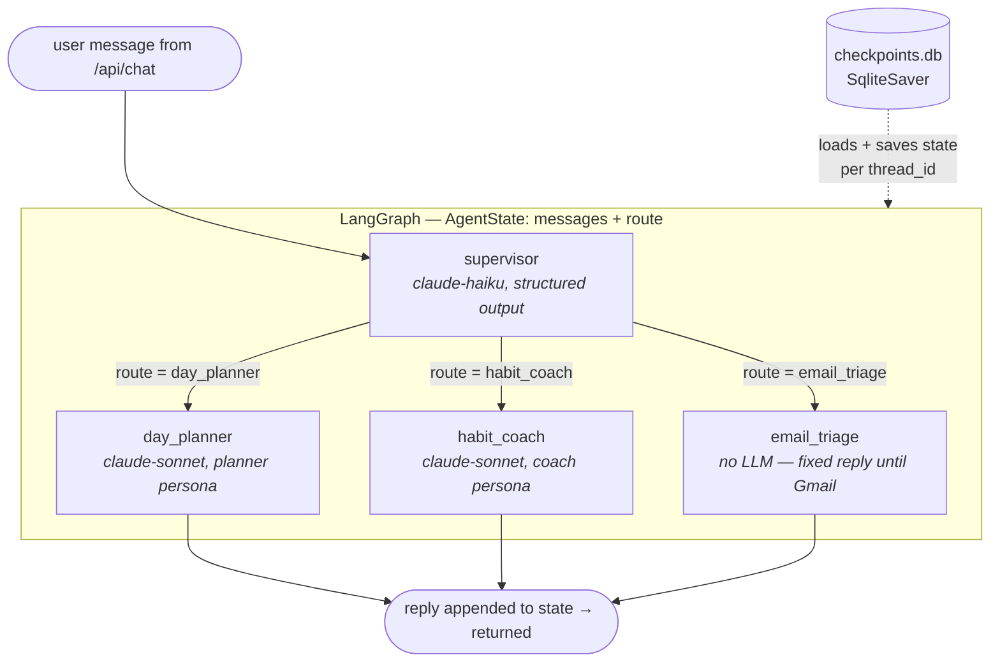

# Recenter — project overview

*Last updated: 2026-10-29. Companion to the [README](../README.md) (setup/run) and the
[Jira board](https://nitin16498.atlassian.net/jira/software/projects/REC/boards) (backlog).*

## What this is

Recenter is a chat-first **AI chief of staff** built on Atomic Habits principles.
One conversation window (like Claude's UI) backed by three specialist agents:

- **Habit coach** — you define who you want to become (identity), it builds habit
  stacks that vote for that identity, tracks streaks, and recenters you when you
  drift. Never guilt-trips; shrinks the habit instead (2-minute rule, never miss twice).
- **Day planner** — attacks procrastination. You name a big scary task, it breaks
  it down backwards from "done" into one-sitting tasks, then only ever shows you
  the smallest first physical action.
- **Email triage** — reads overnight Gmail, surfaces only what matters, learns
  from thumbs up/down feedback, with a confidence threshold you control.

Three check-ins a day: **morning** (dispatch: today's plan, first small action,
email digest), **afternoon** (nudge, re-shrink if stuck), **night** (the planning
ceremony: review the day, intake new tasks, break down, plan tomorrow). Every
fortnight: a stats review conversation that can mutate habits.

V1 is single-user on localhost. SaaS later.

## Where we are (Sprint 1 — complete-ish)

| Story | What | Status |
| --- | --- | --- |
| REC-6 | App skeleton: React+Vite shell, sidebar nav, FastAPI backend, wiring | Done |
| REC-7 | DB schema: all core tables (see below) | Done |
| REC-8 | Real chat: persisted messages, history, composer | Done |
| REC-9 | LangGraph supervisor + stub subgraphs | Done |
| REC-25 | Provider-agnostic model config (any LangChain provider) | Done — verified live on `openai:*` |
| REC-27 | Board tab: kanban by status, epic/story filters, reusable task detail panel | In review (Sprint 2) |

Everything else (REC-10..24) is backlog: real planner logic, coach persona from
the cheat sheets, habit occurrences engine, Gmail, memory extraction, research node.

## Architecture

```
React (5173) ── /api proxy ──> FastAPI (8000) ──> LangGraph agent ──> Claude API
                                    │                    │
                              recenter.db          checkpoints.db
                          (app data: messages,   (agent conversation
                           habits, tasks, ...)     state per thread)
```

Two SQLite files, deliberately separate concerns:

- **recenter.db** — the product's source of truth. The UI reads chat history from
  `messages`; habits/tasks/stats live here. (We chose our own DB over using Jira
  as a backend: the data model fits the agent, and it keeps the product SaaS-able.)
- **checkpoints.db** — LangGraph's checkpointer. Stores graph state per
  `thread_id`, which is what makes the agent remember the conversation between
  HTTP requests. Delete it and the app still works; the agent just forgets
  mid-conversation context.

### Data model (backend/app/models.py)

- `Identity` — "I am an engineer who ships projects". The root; everything votes for one.
- `Habit` — recurring **template**: cue ("after dinner"), trigger slot
  (morning/lunch/evening), and a `two_minute_version` for low-resistance days.
- `HabitOccurrence` — **one day's instance** of a habit; the checkable item.
  `pending → done | missed`. This is the key design move: check-ins resolve
  occurrences (ask if pending, congratulate if already done), the night ceremony
  marks leftovers missed (arming never-miss-twice), and all stats are just
  aggregates over occurrence rows.
- `Epic → Story → Task` — life areas → objectives with a definition of done →
  one-sitting tasks with a `first_action`. The one-sitting rule: if you can't
  finish it in the sitting you start it, it needs further breakdown.
- `Message` — chat history **for the UI only**. The agent never combs this.
- `MemoryFact` — distilled durable facts ("drives a Honda Civic"), written by an
  extraction step (future REC-22), retrieved by subject. `embedding` column
  reserved for semantic search later.

### Context/memory design (decided, mostly not yet built)

Three layers — the agent never reads all history:

1. **Recent window** — checkpointer state for the current thread; old threads
   compacted by nightly summaries.
2. **Structured queries** — habits, tasks, streaks are already structured; the
   agent calls DB tools, no RAG needed.
3. **memory_facts** — extraction-not-RAG for everything unstructured. Keyword
   lookup first, embeddings when it outgrows that, graph DB only if relationship
   queries actually start failing.

### Board (REC-27)

The Board tab (`frontend/src/pages/Board.jsx`) renders every task as a kanban,
To do / In progress / Done, from `GET /api/board`. Epic and story chips filter
on the client. Dragging a card (native HTML5 DnD) sends
`PATCH /api/tasks/{id}` with the new status, optimistically, and rolls back if
the request fails. Moving a task to `done` stamps `completed_at`; moving it back
clears it. Clicking a card opens `TaskDetailPanel`, a standalone component that
takes a task plus `onSaved`/`onClose` and saves each edit directly through the
same PATCH. REC-11's chat cards will reuse it. The "Show habits" toggle and the
habit card style are in place, but the API returns tasks only until habit
occurrences ship. "By story" view is REC-28.

## The LangGraph agent, in detail

File: `backend/app/agent/graph.py`. This is the supervisor pattern — one router,
three specialists:



*Model names in the diagram are the defaults. Since REC-25, models are
provider-agnostic: `RECENTER_MODEL` / `RECENTER_ROUTER_MODEL` take
`provider:model` strings (e.g. `openai:gpt-4o`) built by `agent/llm.py` —
no node code knows which provider it's talking to.*

### The pieces

**State — `AgentState`.** A LangGraph graph is a state machine. Our state is
`MessagesState` (the running message list, with *append* merge semantics — a node
returning `{"messages": [reply]}` appends rather than overwrites) plus one extra
field, `route`. Every node is a function `state -> partial update`; LangGraph
merges the updates.

**`supervisor` node.** The traffic cop. Calls the cheap/fast model (haiku) with
`with_structured_output(Route)` — a Pydantic model whose `destination` field is a
`Literal["day_planner", "habit_coach", "email_triage"]`. Structured output means
the LLM must return a parseable routing decision, not prose — no regex guessing.
It writes `{"route": ...}` into state and nothing else. It never talks to the user.

**The conditional edge.** `add_conditional_edges("supervisor", route_from_supervisor, {...})`
is where the graph branches: after supervisor runs, LangGraph calls
`route_from_supervisor(state)` (which just reads `state["route"]`) and follows the
matching edge. This is the LangGraph idiom for if/else.

**`day_planner` node.** Stub persona on sonnet: pragmatic, anti-procrastination,
at most one clarifying question, always points at the smallest first physical
action. Its real version (REC-10) will interrogate → break down backwards →
persist Story+Tasks to the DB → prescribe only step one.

**`habit_coach` node.** Stub persona on sonnet: warm, identity-focused, votes
language, shrink-don't-skip, never miss twice. Real version (REC-15..17) gets a
system prompt distilled from the Atomic Habits cheat sheets plus DB tools to
read/write habits and occurrences. Also the router's default for greetings.

**`email_triage` node.** No LLM at all — an honest fixed reply saying Gmail isn't
connected yet. A node that doesn't call a model is a legitimate node; when
REC-18..21 land, this becomes its own subgraph (fetch → classify with confidence
→ digest cards → feedback learning).

**Checkpointer.** `builder.compile(checkpointer=SqliteSaver(conn))`. Before each
run, LangGraph loads prior state for the `thread_id` in the config; after, it
saves. That's why "what did I just tell you?" works across separate HTTP requests.
(The `-shm`/`-wal` files next to `checkpoints.db` are normal SQLite write-ahead
log artifacts.)

**Entry point.** `run_agent(content, thread_id)` wraps it for FastAPI: build a
typed initial state with the new `HumanMessage`, invoke with
`config={"configurable": {"thread_id": ...}}`, return the last message's text.
`/api/chat` persists the user message and the reply to `recenter.db` around this
call, with a graceful fallback message if the model call fails.

### Why this shape scales

Each future feature is a change to exactly one place: smarter planner = rewrite
one node into a subgraph; new capability (research, doc-QA) = new node + a line
in the router prompt; the supervisor and the API wiring never change. That's why
REC-9 was worth doing before any "real" agent logic.

## What's next (Sprint 2 candidates, in proposed order)

1. **REC-10 — collaborative breakdown flow.** The planner interrogates (max 1-2
   questions), breaks down backwards from done, persists Story+Tasks, prescribes
   the first physical action. Attacks the procrastination problem directly.
2. **REC-11 — inline task cards in chat.** Agent messages can embed checkable
   task cards; checking off writes to the DB. The pattern the whole UI relies on.
3. **REC-15 — coach persona from the cheat sheets.** Distill the four PDFs into
   the habit_coach system prompt.
4. Then: habit occurrences engine + streaks (REC-16/17), night ceremony (REC-12),
   morning dispatch (REC-13), Gmail epic (REC-18+), memory extraction (REC-22).

## Working agreements

- Kanban via Jira REC project; one component deep-dive per session; stories end
  with acceptance criteria ("done when").
- Ship small, avoid perfectionism loops — the identity being built here is
  "engineer who ships," and every commit is a vote.
- Design decisions get recorded as Jira comments on the story that decided them.
